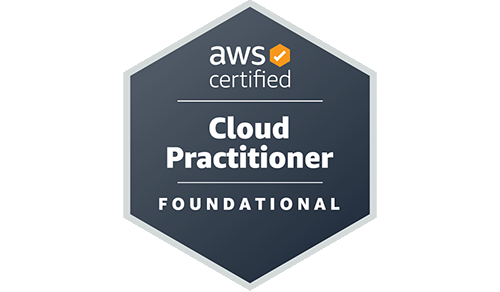
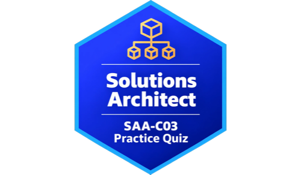
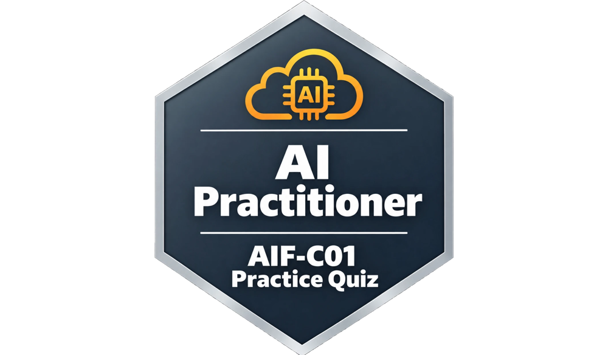

<div align="center">
  
  
  

  # AWS Practice Exams
  
  **Simulatore d'esame per le certificazioni AWS Cloud Practitioner (CLF-C02), Solutions Architect – Associate (SAA-C03) e AI Practitioner (AIF-C01)**

  
  
  
  

</div>

---

## Cosa è

Un simulatore d'esame client-side per prepararsi alle certificazioni **AWS Certified Cloud Practitioner (CLF-C02)**, **AWS Certified Solutions Architect – Associate (SAA-C03)** e **AWS Certified AI Practitioner (AIF-C01)**. La certificazione si sceglie dal selettore in cima alla home (o con i link `?cert=saa` / `?cert=aif`); domini, tempi, soglia e storico cambiano di conseguenza. Gira interamente nel browser — nessun backend, nessuna installazione, nessun account richiesto.

## Modalità d'esame

| Modalità | Domande | Tempo CLF-C02 | Tempo SAA-C03 | Tempo AIF-C01 |
|---|---|---|---|---|
| ⚡ Flash Quiz | 15 | 20 min | 30 min | 20 min |
| 📝 Short Practice | 35 | 50 min | 70 min | 50 min |
| 🎯 Official Simulation | 65 | 90 min | 130 min | 90 min |

Ogni simulazione estrae le domande casualmente dalla bank, la cui composizione rispetta i pesi ufficiali dei domini. Soglia di superamento: 70% per CLF-C02 e AIF-C01, 72% per SAA-C03. La AIF-C01 include anche domande di **ordinamento** (riordinare i passaggi con ↑ ↓) e di **abbinamento** (associare ogni voce alla risposta giusta), come l'esame reale.

## Domini e distribuzione

**CLF-C02**

| Dominio | Peso ufficiale | Domande nel bank |
|---|---|---|
| Cloud Concepts | 24% | 120 |
| Security & Compliance | 30% | 150 |
| Cloud Technology & Services | 34% | 170 |
| Billing, Pricing & Support | 12% | 60 |
| **Totale** | **100%** | **500** |

**SAA-C03**

| Dominio | Peso ufficiale | Domande nel bank |
|---|---|---|
| Design Secure Architectures | 30% | 135 |
| Design Resilient Architectures | 26% | 117 |
| Design High-Performing Architectures | 24% | 108 |
| Design Cost-Optimized Architectures | 20% | 90 |
| **Totale** | **100%** | **450** |

**AIF-C01**

| Dominio | Peso ufficiale | Domande nel bank |
|---|---|---|
| Fundamentals of AI and ML | 20% | 60 |
| Fundamentals of GenAI | 24% | 72 |
| Applications of Foundation Models | 28% | 84 |
| Guidelines for Responsible AI | 14% | 42 |
| Security, Compliance, and Governance for AI Solutions | 14% | 42 |
| **Totale** | **100%** | **300** |

## Funzionalità

- ✅ 1250 domande originali (500 CLF-C02 + 450 SAA-C03 + 300 AIF-C01) con spiegazione dettagliata per ogni opzione
- ✅ Le nuove simulazioni danno la precedenza alle domande non ancora viste
- ✅ Esame in corso salvato: si riprende dopo un ricaricamento o una chiusura della scheda
- ✅ Andamento della preparazione (grafico del punteggio e variazione per dominio)
- ✅ Tema chiaro / scuro
- ✅ Storico delle sessioni con le domande sbagliate più spesso
- ✅ Domande singole e multi-risposta
- ✅ Timer con avvisi visivi (arancione < 10 min, rosso < 5 min)
- ✅ Griglia di navigazione laterale con stato per ogni domanda
- ✅ Possibilità di segnare le domande con flag per rivederle
- ✅ Schermata risultati con punteggio, breakdown per dominio e revisione di tutte le risposte
- ✅ Soglia di superamento come l'esame reale (70% CLF-C02 e AIF-C01, 72% SAA-C03)
- ✅ Scorciatoie da tastiera (frecce, F per flag, 1–5 / A–E per rispondere)
- ✅ Funziona offline e via `file://` — nessun server necessario

## Come usarlo

### Online
Visita il sito deployato su Vercel *(link in arrivo)*.

### In locale
```bash
git clone https://github.com/dimmijose29/aws-c02-practice.git
cd aws-c02-practice
# Apri index.html nel browser — non serve nient'altro
open index.html
```

## Scorciatoie da tastiera

| Tasto | Azione |
|---|---|
| `→` / `↓` | Domanda successiva |
| `←` / `↑` | Domanda precedente |
| `F` | Aggiungi/rimuovi flag |
| `1`–`5` o `A`–`E` | Seleziona risposta |

## Struttura del progetto

```
aws-c02-practice/
├── index.html          # Struttura HTML (3 schermate: start, quiz, risultati)
├── css/
│   └── style.css       # Tutti gli stili
├── js/
│   ├── questions.js    # Bank CLF-C02 (500 domande)
│   ├── questions-saa.js # Bank SAA-C03 (450 domande)
│   ├── questions-aif.js # Bank AIF-C01 (300 domande)
│   ├── question-types.js # Tipi di domanda: singola, multipla, ordinamento, abbinamento
│   ├── session.js      # Quiz in corso e domande già viste (localStorage)
│   ├── certs.js        # Configurazione per certificazione
│   ├── state.js        # Stato globale dell'applicazione
│   ├── timer.js        # Logica timer
│   ├── render.js       # Rendering UI
│   ├── stats.js        # Storico sessioni (localStorage)
│   ├── cheatsheet.js   # Cheat sheet di studio
│   ├── results.js      # Calcolo e visualizzazione risultati
│   └── app.js          # Entry point, logica e event listeners
└── img/
    ├── logo.png
    ├── logo-saa.png
    ├── logo-aif.png
    └── favicon.png
```

---

<div align="center">
  <sub>Progetto personale per la preparazione all'esame CLF-C02 · Non affiliato con Amazon Web Services</sub>
</div>
